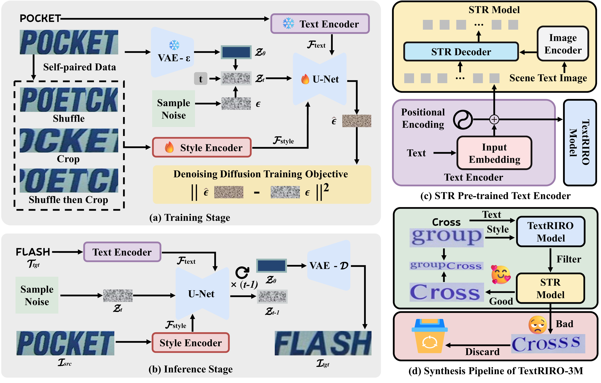
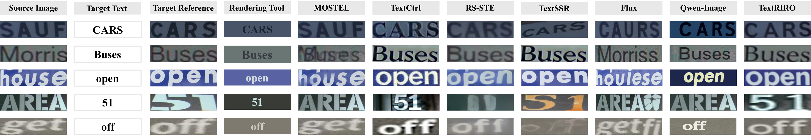
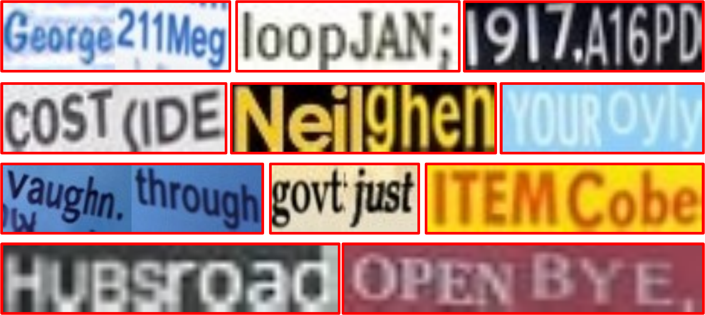

<div align="center">

# Real In, Real Out: What If We Only Use Real Data for Scene Text Editing?

Xingsong Ye<sup>1,2</sup>, Yongkun Du<sup>1,2</sup>, Jiaxin Zhang<sup>3</sup>, Chong Sun<sup>3</sup>, Zhineng Chen<sup>1,2</sup>

<sup>1</sup>Institute of Trustworthy Embodied AI, Fudan University<br>
<sup>2</sup>Shanghai Key Laboratory of Multimodal Embodied AI<br>
<sup>3</sup>WeChat Vision, Tencent Inc.

[NeurIPS 2026](https://neurips.cc/virtual/2026/loc/sydney/poster/153296) · [Model](https://huggingface.co/Yesianrohn/TextRIRO) · [Demo](https://huggingface.co/spaces/Yesianrohn/TextRIRO-Demo) · [TextRIRO-3M](https://huggingface.co/datasets/Yesianrohn/TextRIRO-3M) · [RIROCommon](https://huggingface.co/datasets/Yesianrohn/RIROCommon)

## Overview

**TextRIRO** is a conditional diffusion model for scene text editing: it changes textual content while preserving the original style. We investigate whether scene text editing can be driven by **turning each real sample into its own paired supervision**.

Our **Shuffle&Crop** strategy disrupts text semantics while preserving key style cues. A style encoder extracts multi-scale image features, and a text encoder pre-trained on real scene text with an autoregressive scene text recognition (STR) objective supplies character-level conditioning. This enables the model to learn editing behaviors directly from real text images, without requiring synthetic paired STE training data or character segmentation.

We also introduce **RIROCommon**, a benchmark for equal-length and variable-length editing, and **TextRIRO-3M**, a 3-million-image dataset for long-text recognition built by filtering edited images and concatenating them with their original references.

> “Real-only” refers to the real-data STE supervision and STR-based text-encoder pre-training. TextRIRO uses pre-trained Stable Diffusion components as its generative backbone.

<p align="center">
  
</p>

## Resources

| Resource | Description |
| --- | --- |
| [NeurIPS 2026 paper page](https://neurips.cc/virtual/2026/loc/sydney/poster/153296) | Conference paper and poster page |
| [TextRIRO model](https://huggingface.co/Yesianrohn/TextRIRO) | Released model checkpoints |
| [Online demo](https://huggingface.co/spaces/Yesianrohn/TextRIRO-Demo) | Interactive scene text editing |
| [TextRIRO-3M](https://huggingface.co/datasets/Yesianrohn/TextRIRO-3M) | Synthetic long-text recognition dataset |
| [RIROCommon](https://huggingface.co/datasets/Yesianrohn/RIROCommon) | Equal-length and variable-length editing benchmark |
| [ScenePair outputs](https://huggingface.co/datasets/Yesianrohn/TextRIRO_ScenePair) | Editing results from TextRIRO and comparison methods |

## Installation

The released scripts use CUDA. The commands below retain the Python 3.8 / PyTorch 1.13 environment specified by the repository.

```bash
git clone https://github.com/YesianRohn/TextRIRO.git
cd TextRIRO

conda create -n textriro python=3.8 -y
conda activate textriro

pip install torch==1.13.0+cu116 torchvision==0.14.0+cu116 torchaudio==0.13.0 \
  --extra-index-url https://download.pytorch.org/whl/cu116
pip install -r requirement.txt
pip install lmdb
```

The dependency file is named **`requirement.txt`**. `lmdb` is imported by the training and benchmark scripts but is not listed in that file.

### Prepare checkpoints

Download the TextRIRO checkpoint from [Hugging Face](https://huggingface.co/Yesianrohn/TextRIRO), together with the required backbone components:

- **SD 1.5 U-Net and scheduler:** [stable-diffusion-v1-5](https://huggingface.co/stable-diffusion-v1-5/stable-diffusion-v1-5).
- **SD 2.1 VAE:** [stable-diffusion-2-1-base on ModelScope](https://www.modelscope.cn/models/AI-ModelScope/stable-diffusion-2-1-base).
- **STR-pretrained text encoder:** [`model/text_encoder.pth`](model/text_encoder.pth), included in this repository.

[`configs/train.yaml`](configs/train.yaml) is used for both training and inference. Its default paths expect:

```text
TextRIRO/
├── textriro.pth                         # downloaded TextRIRO checkpoint; or use --ckpt_path
├── model/
│   ├── text_encoder.pth
│   ├── stable-diffusion-v1-5/
│   │   ├── scheduler/
│   │   │   └── scheduler_config.json
│   │   └── unet/
│   │       └── diffusion_pytorch_model.bin
│   └── stable-diffusion-2-1/
│       └── vae/                         # complete Diffusers-format VAE directory
│           ├── config.json
│           └── ...                      # VAE weights
└── configs/
    └── train.yaml
```

The committed `scheduler`, `unet`, and `vae` paths are empty placeholder files. Replace them with the corresponding model directories, or store the downloaded components elsewhere and update these fields:

```yaml
model:
  params:
    base_config:
      scheduler_config: "model/stable-diffusion-v1-5/scheduler/scheduler_config.json"
      vae:
        pretrained: "model/stable-diffusion-2-1/vae/"
      unet_pretrained: "model/stable-diffusion-v1-5/unet/diffusion_pytorch_model.bin"
      text_encoder:
        params:
          ckpt_path: "model/text_encoder.pth"
```

This YAML excerpt identifies path fields to edit; keep the remaining configuration entries. If the released TextRIRO checkpoint has a different filename, pass its actual path through `--ckpt_path`.

## Inference

### Edit cropped text images

Prepare a directory containing source images and their target strings:

```text
example/
├── i_s/
│   ├── sample_001.png
│   └── sample_002.jpg
└── i_t.txt
```

Each line of `i_t.txt` contains **the image filename, one space, and the target text**. Target text may itself contain spaces:

```text
sample_001.png FLASH
sample_002.jpg Real In Real Out
```

Every source image in `i_s/` must have a corresponding entry. Run from the repository root:

```bash
python inference.py \
  --ckpt_path textriro.pth \
  --dataset_dir example \
  --output_dir example_result \
  --num_inference_steps 20 \
  --guidance_scale 2.2 \
  --seed 42
```

Outputs are saved with the source filenames in `example_result/`. The script resizes inputs to **64 × 256** for generation and resizes outputs back to the original image dimensions. It edits cropped text images; full-scene text detection and compositing are outside this script.

The current text encoder uses [`EN_symbol_dict.txt`](EN_symbol_dict.txt) plus the space character and a maximum target length of **25 characters**. Longer targets are truncated by the encoder. Broader language coverage requires compatible training data, vocabulary, and checkpoints.

### Run RIROCommon inference

Download [RIROCommon](https://huggingface.co/datasets/Yesianrohn/RIROCommon) and extract its LMDB directories. The input reader expects `num-samples` and these keys for each 1-based, zero-padded sample index:

| Key | Content |
| --- | --- |
| `image-000000001` | Source image bytes |
| `label-000000001` | Original text, UTF-8 |
| `editlabel-000000001` | Target text, UTF-8 |

For example, using the directory convention in the script:

```bash
python inference_RIROCommon.py \
  --config configs/train.yaml \
  --ckpt_path textriro.pth \
  --input_lmdb RIROCommon/Equal/IC13 \
  --output_lmdb RIROOut/Equal/IC13 \
  --num_inference_steps 20 \
  --guidance_scale 2.2 \
  --batch_size 32 \
  --seed 42
```

Set `--input_lmdb` to each extracted equal-length or variable-length subset and use a separate output directory for each run. The benchmark script's built-in CFG default is **1.8**, so the command explicitly sets the paper's inference setting of **2.2**.

The output LMDB stores edited images under `image-*`, target labels under `label-*`, original images under `ori-*`, original labels under `orilabel-*`, and output dimensions under `wh-*`, together with `num-samples`.

## Training

### Real training data

TextRIRO uses **U14M-Filter**, the filtered real-data subset of [Union14M](https://github.com/Mountchicken/Union14M), containing **3.22M images**. Download the [OpenOCR LMDB version](https://huggingface.co/datasets/topdu/OpenOCR-Data/tree/main/Union14M-L-LMDB-Filtered) and update `data.train.lmdb_paths` and `data.validation.lmdb_paths` in [`configs/train.yaml`](configs/train.yaml).

Training LMDBs use `image-*`, `label-*`, and `num-samples`. The loader constructs perturbed source images online: with probability **0.7**, it applies column shuffling before cropping; otherwise, it applies cropping directly. The original image and label provide the target supervision.

### STR-based text-encoder pre-training

The paper pre-trains MAERec on real scene text with an autoregressive STR objective. Follow the [OpenOCR MAERec configuration](https://github.com/Topdu/OpenOCR/blob/main/configs/rec/maerec/vit_nrtr.yml), and export the compatible text-embedding weights for `src.CtrlBase.LabelEncoder`. The released embedding is provided as [`model/text_encoder.pth`](model/text_encoder.pth). A full STR checkpoint cannot be used directly in place of this embedding checkpoint.

### Train TextRIRO

After preparing data and model paths:

```bash
python train.py
```

`train.py` reads `configs/train.yaml`. The paper uses **64 × 256** inputs, a learning rate of **1e-5**, a batch size of **256**, and **15 epochs on 8 NVIDIA V100 GPUs**. The VAE and text encoder are frozen; the style encoder and U-Net are trained jointly.

Configure `data.batch_size`, `lightning.accumulate_grad_batches`, and the GPU count for your hardware. The effective global batch is:

```text
per-device batch size × number of GPUs × gradient accumulation steps
```

The checked-in configuration uses a per-device batch size of 32 and accumulation of 8; on eight GPUs this gives 2048, so adjust accumulation to 1 to match the paper's global batch size of 256. The source paper's batch and hardware settings should be distinguished from the repository's current configuration defaults.

## Evaluation and Results

### ScenePair

[ScenePair](https://drive.google.com/file/d/1m_o2R2kFj_hDXJP5K21aC7lKs-eUky9s/view?usp=sharing) contains **1,280 real image pairs**. Generate outputs with `inference.py`, using the dataset's `i_s/` and `i_t.txt`. The paired reference crops are stored in `t_f/`.

The paper reports word accuracy (**ACC**) and normalized edit distance (**NED**) using the official recognizer, together with **FID** for distributional image fidelity. Higher ACC/NED and lower FID are better.

| Method | ACC (%) ↑ | NED ↑ | FID ↓ |
| --- | ---: | ---: | ---: |
| SRNet | 17.84 | 0.478 | 49.22 |
| MOSTEL | 37.69 | 0.557 | 49.19 |
| AnyText | 51.12 | 0.734 | 51.79 |
| TextCtrl | 84.67 | 0.936 | 43.78 |
| TextSSR | 79.69 | 0.924 | 45.37 |
| RS-STE | **91.80** | **0.981** | 49.59 |
| Flux.1 Kontext | 12.81 | 0.460 | 41.59 |
| Qwen-Image-Edit | 53.16 | 0.825 | 49.91 |
| TextFlux | 80.40 | 0.911 | 54.64 |
| **TextRIRO** | **85.23** | **0.964** | **41.53** |
| Real reference | 88.44 | 0.974 | 0.00 |

TextRIRO achieves the lowest FID among the compared editing methods. RS-STE has higher recognizer ACC/NED but worse FID. Recognition scores on real references are a reference point rather than an absolute upper bound on generated-image recognition accuracy.

The current repository contains generation scripts but does **not** include the `evaluation/` directory referenced by the earlier README. For ScenePair metrics, follow the official protocol and the evaluation implementation referenced by [MOSTEL](https://github.com/qqqyd/MOSTEL); do not interpret image generation alone as metric evaluation.

<p align="center">
  
</p>

### RIROCommon

RIROCommon uses six STR benchmarks: **IIIT, SVT, IC13, IC15, SVTP, and CUTE**. Each source image is assigned an **equal-length (E)** target and a **variable-length (V)** target. The paper evaluates with **SVTRv2**, removes non-vocabulary characters and spaces, lowercases the text, and reports normalized word accuracy (%). Averages below are macro-averages across the six benchmarks.

| Method | IIIT E / V | SVT E / V | IC13 E / V | IC15 E / V | SVTP E / V | CUTE E / V | Avg E / V |
| --- | ---: | ---: | ---: | ---: | ---: | ---: | ---: |
| MOSTEL | 16.85 / 12.85 | 10.82 / 3.58 | 10.04 / 7.54 | 11.49 / 6.15 | 7.91 / 3.98 | 7.89 / 5.02 | 10.83 / 6.52 |
| TextCtrl | 64.42 / 11.31 | 76.97 / 10.17 | 74.45 / 12.99 | 73.16 / 15.65 | 70.85 / 10.44 | 64.16 / 11.30 | 70.67 / 11.98 |
| RS-STE | 58.80 / 13.21 | 67.08 / 10.73 | 63.71 / 20.11 | 61.29 / 9.10 | 62.17 / 7.59 | 48.39 / 9.62 | 60.24 / 11.73 |
| **TextRIRO** | **82.74 / 50.47** | **84.39 / 46.14** | **86.23 / 53.49** | **77.91 / 45.28** | **79.69 / 42.31** | **64.87 / 48.12** | **79.31 / 47.64** |

### Train-on-edits STR proxy

The paper also trains MAERec on edited images and their target labels, then evaluates on real STR benchmarks. This measures whether edited samples provide useful recognition training data. “Regular” averages IIIT/SVT/IC13; “Irregular” averages IC15/SVTP/CUTE.

| Training images | Regular (%) | Irregular (%) | Avg (%) |
| --- | ---: | ---: | ---: |
| MOSTEL edits | 58.79 | 41.22 | 50.01 |
| AnyText edits | 78.24 | 61.60 | 69.92 |
| TextCtrl edits | 84.47 | 67.51 | 75.99 |
| RS-STE edits | 82.91 | 70.87 | 76.89 |
| **TextRIRO edits** | **90.79** | **82.56** | **86.67** |
| Real images | 98.58 | 94.96 | 96.77 |

## TextRIRO-3M

Download the dataset from [Hugging Face](https://huggingface.co/datasets/Yesianrohn/TextRIRO-3M).

TextRIRO-3M contains **3M synthetic images**. The symmetric recipe uses source labels of at least four characters, giving generated labels of at least **eight characters** and even lengths. This regularity comes from the concatenation recipe. The supplementary study also examines an asymmetric recipe that concatenates lengths L and L−1 to add odd-length samples; it should not be confused with the default symmetric dataset construction.

<p align="center">
  
</p>
## Acknowledgements

We thank [MOSTEL](https://github.com/qqqyd/MOSTEL), [Union14M](https://github.com/Mountchicken/Union14M), [AnyText](https://github.com/tyxsspa/AnyText), [TextCtrl](https://github.com/weichaozeng/TextCtrl), [OpenOCR](https://github.com/Topdu/OpenOCR), [RS-STE](https://github.com/ZhengyaoFang/RS-STE), and [TextSSR](https://github.com/YesianRohn/TextSSR) for their code, data, and models.

## Citation

```bibtex
@inproceedings{ye2026textriro,
  title     = {Real In, Real Out: What If We Only Use Real Data for Scene Text Editing?},
  author    = {Ye, Xingsong and Du, Yongkun and Zhang, Jiaxin and Sun, Chong and Chen, Zhineng},
  booktitle = {Advances in Neural Information Processing Systems},
  year      = {2026},
  url       = {https://neurips.cc/virtual/2026/loc/sydney/poster/153296}
}
```
